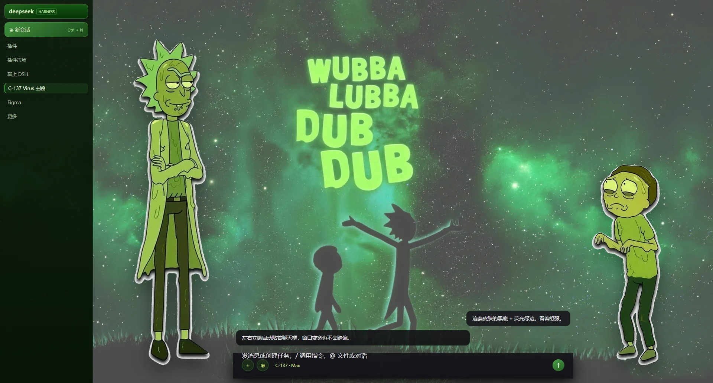

# C-137 Virus

> 荧光绿的深空病毒主题 —— 给 [DeepSeek Harness](https://github.com/deepseek-ai) 的 DSH 皮肤
>
> A neon-green deep-space virus theme for DeepSeek Harness.



## 这是什么

一套完整的 DSH 皮肤：深空星空背景、双角色立绘、卡通风格的九宫格对话框外壳、黑底 + 荧光绿描边配色。

- **纯前端插件**：只改样式和 DOM 装饰，不注入服务、不碰模型请求
- **热切换**：装好刷新页面即生效，卸载即恢复，不需要重启
- **跟随聊天框**：左右立绘各自锚定输入框的左右边缘，窗口变宽变窄都不会跑偏
- **九宫格外壳**：输入框皮肤用 `border-image` 实现，四角不拉伸、四边自适应

## 安装

```sh
dsh plugin --profile <你的profile> add dsh-skin-c137-virus
```

装完**刷新页面**（Ctrl+Shift+R）即可，然后在「设置 → 皮肤管理」里切换。

> 皮肤之间是互斥的，同时启用多套会被管理器回退成官方默认。

## 功能

| 功能 | 说明 |
|---|---|
| 深空背景 | 亮/暗两套背景，随主题自动切换 |
| 双角色立绘 | 左高右矮（比例 1.63:1）· 自动贴聊天框 · 底部留白不压输入框 |
| 对话框外壳 | 九宫格 `border-image` · 12px 1:1 渲染 · 切缝对齐 |
| 荧光绿光标 | `#bafa78`，深色输入区里清晰可见 |
| 配色系统 | 黑底 + 荧光绿，代码块深底、行内代码浅底深字 |
| 窗口适配 | 立绘高度用百分比 · 拥挤时自动隐藏一侧 · 锚点随布局实时重算 |

## 自定义

皮肤素材走 `artwork/` → `tools/apply-artwork.py` 的流程：

```sh
python tools/apply-artwork.py --dry-run   # 看它打算做什么
python tools/apply-artwork.py             # 执行：转格式、算哈希、重写引用
python tools/verify-skin.py               # 自检 20 项
```

槽位清单与尺寸见 [`artwork/README.md`](artwork/README.md)。

## 许可

- **代码**：MIT（见 [LICENSE](LICENSE)）
- **美术**：见 [NOTICE](NOTICE) 与 [LICENSE-ARTWORK](LICENSE-ARTWORK)

## 免责

非官方项目，与 DeepSeek 官方无关。皮肤美术资源的使用请自行确认授权范围。
